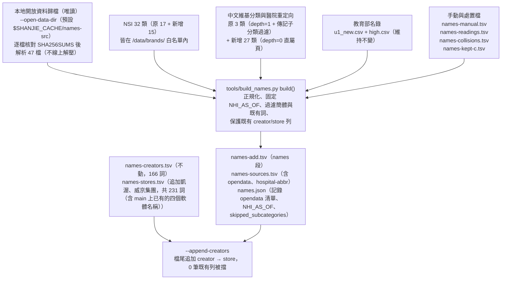

# 契約：下一批名單層非人名專名擴充（names-next）

## 目錄

- [文件目的](#文件目的)
- [要做到什麼](#要做到什麼)
- [怎麼看到它有效](#怎麼看到它有效)
- [驗收](#驗收)
- [停止條件](#停止條件)
- [執行邊界、預算與回退](#執行邊界預算與回退)
- [範圍外](#範圍外)
- [授權與署名更新清單](#授權與署名更新清單)

---

## 文件目的

本契約定義善解輸入法名單層（`data/lexicon/names-*.tsv`）下一批非人名專有名詞擴充片的實作範圍、來源白名單與解析規則、可見驗證方式、出貨標準與公開集合量測計畫、停止條件、執行邊界與回退方案、範圍外項目與授權署名更新。現行名單層（基準 `origin/main` `9118acbf`）中，中文名單檔案共 2,014 列（1,997 不重複詞），對台灣軌道運輸車站、醫院與大型醫療院所、產險與公開發行／上櫃興櫃企業、影城／商場／夜市／藝文場館、重劃區與山岳步道覆蓋稀少。本片在不更動核心 Rust 解碼器演算法、語言模型權重、C ABI（`core/include/shanjie.h`）或 Swift 殼層的前提下，擴充 `tools/build_names.py` 的本地開放資料離線解析器與白名單、補齊 NSI 品牌類別與中文維基實存分類（新增分類採直屬頁 depth-0 並補上子分類傳記過濾），並仿 `data/packs/acg-kept-c.tsv` 新增 `data/lexicon/names-kept-c.tsv` 以在現行 `reading_decode` 下完整離線重建時保留既出貨名單詞，同時併入前批跨 6 個月熱詞檢出且符合 `docs/spec/lexicon-and-packs.md` §3.5 門檻的 2 筆企業名（`凱渥`、`威京集團`），重建 `data/lexicon/names-add.tsv`、`names-sources.tsv` 與 `names.json`，於本機獨立 worktree 分支 `feat/names-next` 完成全部公開集合量測、自動化測試與雙重審查後提交並開立 PR（不合併、不推 tag；私人集合量測與實機／虛擬機驗收由主線接手）。

> **產品片性質：** 本片屬於「只改詞庫與建置工具、不改解碼器演算法與語言模型」的產品片；依出貨標準，第 4 條（錯字回報集）改壞為 0 即算通過（含 `0 / 0`）。所有外部來源僅採用 `LICENSES/data.md` 既有相容授權（政府資料開放授權條款第 1 版、CC BY-SA 4.0、BSD-3-Clause、CC0 1.0），不引入任何 CC BY-NC-SA、CC BY-ND 直接散布內容或人名資料。

---

## 要做到什麼

### 1. 五大非人名擴充類別與精選納入來源

本片涵蓋前 5 大非人名類別（國中小另開一片、人名類不收）。全部外部開放資料均已依序核對 `data.gov.tw` 資料集編號、政府資料開放授權條款第 1 版、檔名與檔案大小，存放於唯讀快取歸檔 `$SHANJIE_CACHE/names-src/`，附完整清單 `MANIFEST.tsv`（80 檔共 48.33 MiB）與 `SHA256SUMS`（80／80 通過校驗）。`MANIFEST.tsv` 中標記為 `ingest`／`ingest_hq_only` 的 **47 份開放資料集（橫跨 23 個台灣政府開放資料主機）** 為本片唯一匯入清單；其餘 33 檔（2 份重複檔＋31 份 `reference_only_*`）不匯入，逐一列於 [範圍外](#範圍外)。

| 類別 | 匯入之政府開放資料（共 47 檔，政府資料開放授權條款第 1 版） | 中文維基分類（CC BY-SA 4.0）與 NSI 擴充（BSD-3-Clause） | 正規化與確定性擷取規則 |
|---|---|---|---|
| **1. 台灣軌道運輸車站**（11 檔） | 國營臺鐵 `33425`（246 站）；內政部國土測繪中心 `73225` 高鐵（12）、`73226` 鐵路（268）、`73230` 輕軌（61）、`73233` 捷運（804）；臺北捷運 `131734`（110）、北市捷運局 `121140`（124）；桃園捷運 `128394`（21）；臺中捷運 `144164`（18）；高雄捷運 `88233`（38）、高雄輕軌 `102184`（38） | 11 份官方開放資料已完整覆蓋臺鐵、高鐵與北北桃中南高各捷運／輕軌車站，無須重複抓取維基車站子樹（節省請求預算並避開廢站雜訊）。NSI 實測無台灣個別車站名，不擴充 `/data/transit/` | 凡含 `出口` 或 `出入口` 之列一律過濾（涵蓋 `73233` 587 筆 `出入口` 列）；剝離路線前綴（`臺鐵`/`台鐵`/`台灣高鐵`/`高鐵`/`臺北捷運`/`北捷`/`新北捷運`/`新北安坑輕軌`/`桃園機場捷運`/`機捷`/`阿里山林業鐵路`/`阿里山林鐵` 等）與編號尾綴（`_Y12`/`_BR21`/`_K1`/`_A6` 等）；`131734` 先剝除外層單引號 `'`（原欄格式為 `'{中文,English}'`）再自 `{中文,English}` 取中文段；通用去除 CSV 雙重與欄位內 BOM（`\ufeff`）；由臺鐵純漢字站名衍生 `<站名>站`／`<站名>車站`，由捷運純漢字站名（剝除尾端 `站` 後）衍生 `<站名>站` 與 `捷運<站名>站`（純漢字 2–10 字）；輕軌站名保留原純漢字站名（如 `輕軌機廠`） |
| **2. 台灣醫院與大型醫療院所**（5 檔） | 衛福部健保署 `39280` 醫學中心（29）、`39281` 區域醫院（86）、`39282` 地區醫院（373）；勞動部勞保局 `6271` 評鑑醫院（139，含聯醫各院區）；國防部軍醫局 `136354` 軍醫院（20） | 5 份官方開放資料已覆蓋全台醫學中心、區域／地區醫院、評鑑醫院與軍醫院；另對正規化後之醫院全名（不先套 10 字上限，以免原始法人全銜被截斷）批次執行維基 `redirects_of()`，依 `is_abbreviation` 收錄醫院通用簡稱（僅取 2–10 純漢字且非簡體之重定向，絕不爬醫院分類子樹，徹底杜絕 `Category:臺灣醫院院長` 等人物頁面）。NSI 醫療類台灣為 0，不增 | 健保署三檔以**固定常數截止日 `NHI_AS_OF = "20261127"`** 過濾（僅收 `終止合約或歇業日期 == ""` 或 `>= NHI_AS_OF` 之有效列，不讀系統時鐘，並寫入 `names.json`）；依序剝除 BOT 委託尾綴（`[（(〈\-－]委託.*$`）、`及其.+$`、`附設民眾診療服務處.*$`、法人前綴（`^.*?(?:醫療財團法人|醫療社團法人|財團法人私立|財團法人|社團法人)`）與宗教前綴（`^(?:天主教|臺灣基督教|基督教|佛教)`）；另以明確規則映射 `^衛生福利部(.+醫院)$` → `部立\1`（如 `衛生福利部苗栗醫院` → `部立苗栗醫院`），保留 2–10 純漢字 |
| **3. 台灣企業、金融保險、電商與連鎖通路**（9 檔＋前批併入 2 列） | 金管會證期局 `18419` 上市（1,098）、`25036` 上櫃（899）、`28568` 興櫃（377）、`28567` 公開發行（298）、`20765`/`11545` 證券商總公司（64）；金管會 `6041` 金融機構總機構（`機構代號 == ""`，158 筆）；銀行局 `28775` 金控（93 列：14 金控＋子公司）；保險局 `7186` 保險公司（52） | 維基（新增 8 類皆採 **depth-0 僅直屬頁**，同時移除兩個已不存在的舊分類 `Category:台灣電子商務網站`、`Category:臺灣的大學`；原 `Category:台灣手搖茶飲品牌`、`Category:台灣餐飲公司`、`Category:台灣公司` 維持 `depth=1` 並套子分類傳記過濾）：`Category:臺灣電子商務`（9）、`Category:臺灣網路書店`（6）、`Category:台灣新聞網站`（63）、`Category:台灣零售商`（34）、`Category:臺灣電信業公司`（21）、`Category:台灣航空公司`（18）、`Category:台灣房屋仲介業`（10）、`Category:臺灣物流公司`（7）。NSI 新增 13 類（`/data/brands/` 內皆實測 `tw > 0`）：`office/{insurance,estate_agent}`、`shop/{optician,furniture,sports,variety_store,books,pet,car,motorcycle,telecommunication}`、`amenity/{ice_cream,parcel_locker}` | 上市／上櫃／興櫃／公開發行收 `公司名稱`（拒絕含 Big5 拆字佔位如 `(牛牛牛)` 之異常列，套 `strip_company`）與 `公司簡稱`（去尾端 `*`、`股份` 與 `-KY` 等非漢字尾綴，限 `≥ 3` 純漢字以避免 2 字常見詞誤收）；`7186` 剝除尾端括號備註（如 `（115.1.1合併前）`、`（原台新人壽）`）並將 `人壽保險事業` 對應為 `人壽`、`產物保險` 對應為 `產險`；`28775` 金控衍生 `<簡稱>金控`；`20765`/`11545` 收證券商名稱（套 `strip_company`）；`6041` 僅收 `機構代號 == ""` 之總機構；**前批跨 6 個月熱詞 `凱渥`（論壇 A 17 篇／12 板）、`威京集團`（論壇 A 10 篇／6 板）依 §3.5 寫入 `data/lexicon/names-stores.tsv`（標籤 `store`，CC0 1.0）** |
| **4. 台灣百貨商場、影城、夜市與藝文場館**（13 檔） | 文化部 `6242` 博物館（144）、`6244` 地方文化館（260）；文化部影視局 `22213` 電影院（107）；原民會 `164242`/`164266` 博物館與文化館（28/110）；觀光署 `38257` 主題樂園（25）、`7777` 全國景點（6,203，篩選場館與步道子集）；經濟部產發署 `6848` 觀光工廠（158）；**五都列管夜市** `121594`（臺北，CP950）、`25965`（桃園）、`85028`（臺中，雙 BOM）、`53634`（臺南，欄內 BOM）、`47005`（高雄） | 維基（新增 11 類皆採 **depth-0 僅直屬頁**）：`Category:台灣購物中心`（55）、`Category:台灣百貨公司`（46）、`Category:台灣暢貨中心`（10）、`Category:台灣連鎖電影院`（11）、`Category:台灣電影院`（14）、`Category:台灣夜市`（14）、`Category:台灣表演藝術場地`（19）、`Category:台灣音樂廳`（15）、`Category:台灣文化藝術中心`（28）、`Category:中華民國文化部指定文化園區`（5）、`Category:台灣當代藝術館`（10）。NSI 新增 2 類：`amenity/cinema`、`tourism/hotel` | 五都夜市 CSV 依實測編碼讀取（`121594` 採 `cp950`，其餘採 `utf-8-sig` 並清除多餘 `\ufeff`），先剝除括號說明與尾端 `攤販集中區`/`攤販臨時集中場`，**一律要求以 `夜市` 結尾**且為 2–10 純漢字（濾除 `121594`/`47005` 裸街名如 `廣州街`、`六合二路` 與片段字串，穩定產出 61 筆純夜市名）；`6242`/`6244`/`164242`/`164266`/`22213`/`38257`/`6848` 去除前後空白與損毀字元 `?` 後取 2–10 純漢字；`7777` 全國景點僅取純漢字 2–10 字且結尾符合 `(商場\|夜市\|樂園\|博物館\|美術館\|園區\|故事館\|紀念館\|影城\|戲院\|古道\|步道\|吊橋\|百貨\|廣場\|劇場\|演藝廳\|文化中心\|藝術中心\|音樂廳)$` 之專名條目 |
| **5. 台灣在地地名、重劃區與山岳步道**（9 檔） | 農業部林保署 `71520` 自然步道（117）、`37675` 國家森林遊樂區（19）；內政部國家公園署 `9963` 步道（105）、`9968` 景點（215）；臺南舊地名 `140066`（23，雙 BOM）；公辦／自辦重劃區 `125432`/`123714`（新北）、`46397`（桃園公辦，含 `草漯`、`小檜溪`）、`53421`（臺南公辦，含 `九份子`、`平實營區`） | 維基（新增 8 類皆採 **depth-0 僅直屬頁**）：`Category:台灣百岳`（105）、`Category:台灣小百岳`（102，含 `貓囒山`）、`Category:台灣古道`（34）、`Category:臺灣國家步道`（18）、`Category:臺灣區域步道`（39）、`Category:台灣重劃區`（6）、`Category:市地重劃區`（11）、`Category:臺灣老街`（49） | `9968` XML（`cp950`）解析前先將裸 `&` 跳脫為 `&amp;`；`140066` 依頓號 `、` 分割 `地名舊稱/俗稱`；剔除含 `?` 損毀列（如 `125432` 第 9 列）；重劃區去除換行、`第[一二三四五六七八九十0-9]+期`、尾端 `(?:自辦)?市地重劃區?`、`-一`/`-二`/`一、二` 期別尾綴與前綴行政區名（如 `46397` 保留 `草漯`、`小檜溪`、`田心子` 等 2–10 純漢字短稱；`53421` 擷取 `九份子`、`平實營區`、`長勝營區` 等）；**不**納入 `7064`、`131138`、`136837` 與其餘高雜訊重劃統計／工程標案檔 |

### 2. `tools/build_names.py` 建置工具擴充設計

上圖為本片唯一建置資料流。工具改動重點如下：

| 改動項目 | 實作規格 |
|---|---|
| **白名單 `allowed(url, commit)` 與 `OPEN_DATA_HOSTS`** | 保留既有 5 主機規則（`stats.moe.gov.tw` 仍嚴限 `.csv`，不破壞既有 `test_allow_list` 負向斷言）；新增 `OPEN_DATA_HOSTS` 註冊 47 份納入資料集對應之 **23 個台灣政府開放資料主機**（`apiservice.mol.gov.tw`、`cloud.culture.tw`、`data.cip.gov.tw`、`data.kcg.gov.tw`、`data.moa.gov.tw`、`data.ntpc.gov.tw`、`data.tainan.gov.tw`、`data.taipei`、`file.moc.gov.tw`、`info.nhi.gov.tw`、`ins-info.ib.gov.tw`、`media.taiwan.net.tw`、`mopsfin.twse.com.tw`、`newdatacenter.taichung.gov.tw`、`ods.railway.gov.tw`、`opdadm.moi.gov.tw`、`opendata.tycg.gov.tw`、`stat.fsc.gov.tw`、`www.banking.gov.tw`、`www.ida.gov.tw`、`www.mnd.gov.tw`、`www.tgos.tw`、`www.twse.com.tw`；嚴格 `https`、無 port、無 userinfo，`_Redirect` 同樣檢核轉址目標） |
| **本地預解開放資料載入與 `SHA256SUMS` 驗證** | 新增 `--open-data-dir DIR`（預設 `$SHANJIE_CACHE/names-src`）與固定註冊表 `OPEN_DATA_SPECS`（47 筆，每筆綁定 `dataset_id`、相對路徑 `relpath`、來源網址、提供機關、格式 `csv`/`json`/`xml`/`zip_dbf`、編碼與專用正規化函式）。`build()` **一律直接讀取 `--open-data-dir` 下已預先核對之本地檔案**（`7777`、`9963`、`9968` 讀已預解出之 `.json`/`.xml`，不於執行期線上抓取或解壓 `.rar`/`.zip`；僅國土測繪 `73225`/`73226`/`73230`/`73233` 依 Python 標準庫 `zipfile` 讀本地 `.zip` 內 `.dbf`），讀檔前核對 `SHA256SUMS` 雜湊（不符或短缺即以錯誤碼中止，觸發 S6），並記錄每檔 SHA-256、列數與 `NHI_AS_OF = "20261127"` 於 `names.json` 的 `opendata` 欄 |
| **維基子分類傳記過濾與 depth 控制** | `WIKI_CATEGORIES` 支援每類指定深度：既有 3 類（`Category:台灣手搖茶飲品牌`、`Category:台灣餐飲公司`、`Category:台灣公司`）維持 `depth=1`，新增 27 類全採 `depth=0`（只抓直屬頁，不展開實體主題與人物子樹）。任何 `depth=1` 分類強制套用 `EXCLUDED_SUBCATS`（明列 `Category:臺灣醫院院長` 等）與傳記／職稱子分類關鍵字過濾 `BIO_SUBCAT_RE`（`院長\|人物\|創辦人\|董事長\|總裁\|執行長\|館長\|校長\|校友\|員工\|企業家\|政治人物\|藝人\|歌手\|演員\|導演\|作家`），被跳過之子分類全數記錄於 `names.json` 的 `skipped_subcategories`。醫院簡稱重定向改以 5 檔正規化醫院名（不先套 10 字截斷）批次呼叫 `resolve_titles` + `redirects_of`，僅收符合 `is_abbreviation` 且為 2–10 純漢字之非簡體簡稱（來源種類標 `hospital-abbr`） |
| **維基查詢預算與獨立快取隔離** | 維持 `zh.wikipedia.org/w/api.php` 每秒 `≤ 1` 次請求、`User-Agent` 與 `maxlag=5`，遇 `HTTP 429`/`503` 依 `Retry-After` 標頭禮貌休眠重試；維基標題查詢採每批 50 筆 `action=query`（`inprop=displaytitle|varianttitles`＋`Template:NoteTA` 偵測），僅含 `NoteTA` 或缺 `zh-tw` 標題之條目回退單頁 `action=parse`，批次鍵僅依排序標題決定以確保離線 100% 命中快取。新增 `MAX_REQUESTS = 3500`（原 3,000）並保留 `MAX_CACHE = 500_000_000`（僅計入 `NamesApi` 活抓快取目錄，不計入唯讀 `--open-data-dir`）。實作以既有 `$SHANJIE_CACHE/sources/names/` 複製為底建置獨立快取 `$SHANJIE_CACHE/sources/names-next/`（透過 `--cache` 指定），不寫入或汙染其他 worktree 共用快取 |
| **保護已出貨 `creator`／`store` 列** | 主流程 `build()` 讀取既有 `names-creators.tsv` 與 `names-stores.tsv`（均為可注入參數）的詞集與讀音鍵：既有 `creator`/`store` 字串不重複進 `names` 標籤（避免 `append_creators` 報 `bad store/creator row`），若新候選詞與既有已出貨 `creator`/`store` 讀音相同，自動讓位不加入 `names` 段（記錄於 `dropped["reserved_for_creator_store"]`），確保既有 166 筆 `creator` 與 231 筆 `store`（原 225＋軟體名稱 4 列（`善解`、`善解輸入法`、`唯音`、`唯音輸入法`，已在 main）＋`凱渥`、`威京集團`）零流失、零被擋 |
| **9 份詞庫／詞包詞檔零重複、0 衝突與 `names-kept-c.tsv`** | `known_words()`、`check_committed()` 與 `append_creators()` 完整涵蓋 `docs/spec/lexicon-and-packs.md` §1.1 定義之全部 **9 份詞庫／詞包詞檔**（`mcbpmf-data.txt`、`overlay-add.tsv`、`sandhi-add.tsv`、`names-add.tsv`、`acg-add.tsv`、`it-add.tsv`、`meme-add.tsv`、`beauty-add.tsv`、`quotes-add.tsv`），確保 `names-add.tsv` 與其餘 8 份檔交集為空。維持類型 `(c)` 自動剔除與類型 `(a)`（名單內同音及 `acg` 詞包同音）寫入 `build/names/collisions.txt` 並人工處置進 `names-collisions.tsv`，直至 `unresolved_collision_readings == 0`。為使現行 `reading_decode` 下完整離線重建不致誤刪既出貨名單詞，仿 `data/packs/acg-kept-c.tsv` 新增建置輸入檔 `data/lexicon/names-kept-c.tsv`（三欄 TSV：`讀音\t名字詞\t被擠下的詞庫詞`，讀音採空白分隔音節以對齊 `acg-kept-c.tsv` 與 `detect_collisions` 鍵格式；載入時嚴格驗證三欄格式、音節數等於詞長且 `(讀音, 詞)` 不重複，不符即中止；只收基準 `9118acbf` 已出貨之 10 筆名單詞：`卜蜂`、`臺中一中`、`臺南大學`、`臺灣電視`、`投高`、`南僑`、`歌林`、`國巨`、`爭鮮`、`映泰`）。類型 `(c)` 迴圈內對符合 `(讀音, 詞)` 之項目豁免自動剔除；後段彙整 `col`（`unresolved_collision_readings`）時，**僅略過 `e[1] == "c"` 且 `(r, w)` 屬於 `kept_c` 之項目**，同一讀音上任何類型 `(a)` 或 `with_pack` 衝突仍完整保留檢查不遮蔽；`names.json["kept_c"]` 記錄實際觸發並豁免之**不重複 `(讀音, 詞)` 對數**（非聊天／書面原始命中次數）；新詞若觸發 `(c)` 仍一律剔除。另針對與基底 `mcbpmf-data.txt` 同音且在出貨設定下會拆斷既有長詞之衝突（本次重跑浮現之舊學校重定向 `大里高中` 撞基底 `大理高中` 並使書面 `市大里高中` 拆成 `是大里高中`），於 `names-collisions.tsv` 明列排除（同批浮現之 `國臺藝`、`臺中教大`、`鳳商` 均非基底同音且不拆斷長詞，依同一規則保留） |
| **CI 測試隔離設計** | `build()` 將 `open_data_specs=OPEN_DATA_SPECS`、`open_data_dir=None`、`creators_tsv=CREATORS`、`stores_tsv=STORES`、`kept_c_tsv=KEPT_C_TSV`、`it_add`、`beauty_add`、`quotes_add` 全數設計為可注入參數（`open_data_dir=None` 且 `open_data_specs=()` 時不碰磁碟快取），使 `tools/test_build_names.py` 在無 `$SHANJIE_CACHE/names-src` 的 CI 環境完全隔離可過 |
| **多音字與讀音核對** | `build/names/check-readings.txt` 列出全部含 `POLY` 字（`樂行長重藏都會種朝`）或 `tools/readings.py` 標 `CHECK` 的新詞，逐筆確認台灣標準讀音並寫入 `data/lexicon/names-readings.tsv`（如 `草漯` `ㄘㄠˇ ㄊㄚˋ`），不修改 `tools/reading_overrides.tsv` |

### 3. 同步更新檔案清單

| 檔案 | 更新內容 |
|---|---|
| `docs/contracts/names-next.md` | 本契約 |
| `tools/build_names.py` | 擴充白名單（`OPEN_DATA_HOSTS`）、`OPEN_DATA_SPECS`（47 檔）與 5 類解析器、`NHI_AS_OF = "20261127"`、`EXCLUDED_SUBCATS`＋`BIO_SUBCAT_RE`、`NSI_CATEGORIES`（+15）、`WIKI_CATEGORIES`（原 3 類 depth-1＋新 27 類 depth-0）、醫院簡稱重定向、50 筆批次維基查詢與 `HTTP 429/503 Retry-After`、`names-kept-c.tsv` 讀取與 `(c)` 豁免（`manifest["kept_c"]`）、`creator`/`store` 保護、9 檔去重、`--open-data-dir`、`MAX_REQUESTS = 3500` 與 CI 注入參數 |
| `tools/test_build_names.py` | 更新 `PRE_APPEND_NAMES_ADD_SHA256`、`manifest["sources"]` 鍵集合斷言；新增白名單正負測試、5 類開放資料解析器單元測試（使用取自 `$SHANJIE_CACHE/names-src/` 之**逐字裁剪夾具**，保留 `131734` 含外層單引號 `'{中文,English}'` 原文與 `53421` `第六期長勝營區`，驗證產出 `部立苗栗醫院`、`捷運葫洲站`、`邁達特`、`奇鋐科技`、`犇亞證券`、`淡水禮萊國賓影城`、`佳里傳統夜市`、`長勝營區` 與過濾 `73233` `出入口`、`121594` 裸街名、`28567` `(牛牛牛)`／`股份`）、`NHI_AS_OF` 不依系統日期測試、巢狀 `Category:臺灣醫院院長` 人物頁 0 納入測試、`RateLimitRetry`／`TwTitlesBatch`（含 `NoteTA` 後離線重現）測試、`names-kept-c.tsv` 豁免（含同讀音 `(a)` 衝突不被遮蔽與格式錯誤／重複列中止）測試、`creator`/`store` 保護測試、9 檔去重測試與雙次離線逐位元組重現測試 |
| `tools/testdata/names/opendata/*` | 由 `$SHANJIE_CACHE/names-src/` 逐字裁剪之 5 類開放資料單元測試夾具（含 `131734` 原始單引號格式、`53421` 臺南公辦重劃區等）與夾具用 `SHA256SUMS`（均屬政府資料開放授權條款第 1 版摘錄，於 `LICENSES/data.md` 署名） |
| `data/lexicon/names-stores.tsv` | `names-stores.tsv` 依 §3.5 追加 `凱渥`、`威京集團`（2 列，CC0 1.0，置於軟體名稱四列之前，維持「檔尾四列是軟體名稱」）；產品名 `善解`、`善解輸入法`（與 `唯音`、`唯音輸入法`）已由 main 的 `names-stores.tsv` 檔尾四列提供，本片不另放 `names-manual.tsv`，並驗證它們不壓過 `善解人意` 與強人稱語境 `謝謝善姐幫忙` |
| `data/lexicon/names-readings.tsv`、`names-collisions.tsv`、`names-kept-c.tsv` | 補入本次新詞之多音字／在地讀音核對列、同音衝突處置列（含排除 `大里高中`），並新增 `names-kept-c.tsv`（CC BY-SA 4.0，建置輸入不進 App，固定保留基準 `9118acbf` 已出貨之 10 筆名單詞） |
| `data/lexicon/names-add.tsv`、`names-sources.tsv`、`names.json` | 由 `tools/build_names.py` 離線重建之最終產物（含 `--append-creators`），**確認保留 `臻鼎`（`cli/tests/golden.rs:592`）與 `湯臣`（`core/tests/engine_newword.rs:475`）** |
| `docs/spec/lexicon-and-packs.md` | 同步更新 §3.1、§3.2、§3.4、§3.5、§3.7（新增 47 檔開放資料來源、`NHI_AS_OF`、擴充 NSI 類別、維基 depth 與傳記子分類過濾、`names-kept-c.tsv`、9 檔零重複、主機白名單、批次查詢與 `HTTP 429/503 Retry-After` 及 `MAX_REQUESTS`） |
| `LICENSES/data.md`、`scripts/build-app.sh`、`scripts/check-app.sh` | 同步新增本片實際納入 47 檔政府開放資料所屬 30 個提供機關與資料集編號署名；於 `LICENSES/data.md` 補上 `data/lexicon/names-kept-c.tsv` 獨立列（CC BY-SA 4.0，署名同 `names-add.tsv`，建置輸入不進 App）並更新 `tools/testdata/names/*` 列以署名 `tools/testdata/names/opendata/*` 所含政府資料開放授權條款第 1 版提供機關；並核對 `scripts/windows/build-msi.ps1` 對 `build-app.sh` 的擷取與驗證條件 |
| `eval/golden/*`、`cli/tests/golden.rs` 與 `cli/tests/reading_decode.rs` | 凡預設載入 `data/lexicon/names-add.tsv` 且因詞庫雜湊或解碼變更受影響之 golden／pin 一併檢查並依規處理：Python 參考類（`digits-{pred,reorder,score}.txt`、`sp-predict.txt`、`s1-dev302.txt`、`s1-overlay-sets.txt`、`s2r-probe-unigram.txt`、`s2-lm.txt`、`s2h-lm-context.txt`、`s2-lm-dev302-top1.tsv`、`s2-lm-dev302-{chat,formal}{,-jv2,-jv2-accept}.rowstats`、`sw-probe.txt` 及 `cli/tests/golden.rs:269,273`）以 `reference/proto/` 對應腳本重產並確認與 Rust 逐位元一致；`cli/tests/reading_decode.rs` 的 64-best `--dump` 雜湊 pin（`DUMP_BEFORE`）僅於確認所有列第一名不變、差異全為新增專名進入次選候補後方得更新；Rust 專屬出貨 pin（`eval/golden/reading-decode-shipping.txt`）僅於確認逐列差異皆屬零退步（滿足出貨標準第 2、4 條）後方得更新 |
| `eval/dev/names/stores.txt`、`names.txt` | `stores.txt` 依 `LICENSES/data.md` 補入 `凱渥`、`威京集團`（main 上 229 列 → 231 列，含 main 已加的四個軟體名稱；本片前的 225 列子集照樣對比）；`names.txt` 維持 61 列；量測回歸時以原 225／61 列子集對比基準確認改壞 = 0 |

---

## 怎麼看到它有效

本片以「五大類各 5 例（共 25 例）出貨 CLI 實測改前／改後」與「6 份公開開發集＋`--dev 302`／打字測驗／錯字回報兩種設定配對比較表」呈現效果；私人集合與 tart macOS 虛擬機 App 實打由主線接手完成。

### 1. 五大類各 5 例出貨設定實測（共 25 例，單詞＋自然短句）

使用現行完整出貨設定（`data/models.tsv`：`通語 SJ-LM-7-9.7M`、`辨類 SJ-WC-6-512C`、`承接 SJ-KN-2-397K`、`連文 SJ-CX-2-7.7M`／`SJ-CX-2-950K`、`會意 SJ-SR-10-31M`、`常談 SJ-CL-2-69K`，即 `target/release/shanjie-eval --lm data/lm/bigram.sjlm --profile <chat|formal> --context --packs acg,it,meme,beauty --tinylm data/lm/tinylm.sjtl` 加上聊天用 `--colloquial-core data/lm/colloquial.sjlm`），以 `--picks` 驗證基準 `origin/main`（`9118acbf`）與本片重建後的 `data/lexicon/names-add.tsv`（直接載入重建後詞庫，不靠 `--extra-overlay`）：

| 類別 | 必驗 5 例（對應確定性來源與規則） | 基準已實測打錯項目（`origin/main` `9118acbf`） | 改後預期（聊天與書面單詞＋短句皆全數精確命中） |
|---|---|---|---|
| **1. 台灣軌道運輸車站** | `崎頂站`（`33425`/`73226`）、`菁桐站`（`33425`/`73226`）、`東澳站`（`33425`/`73226`）、`捷運葫洲站`（`131734`/`121140`/`73233` 衍生規則）、`輕軌機廠`（`102184`/`73230`） | 雙設定錯：`崎頂站`（其頂站／奇頂站）、`輕軌機廠`（輕軌機場）；聊天單詞與短句錯：`菁桐站`（經同站／京同站）、`東澳站`（東奧站）、`捷運葫洲站`（捷運湖州站） | 5／5 單詞與短句於聊天、書面雙設定全數精確輸出目標站名 |
| **2. 台灣醫院與大型醫療院所** | `部立苗栗醫院`（`39281`/`6271` 部立規則）、`聖馬爾定醫院`（`39281`/`6271` 法人＋宗教前綴剝除）、`義大癌治療醫院`（`39281`/`6271` 法人前綴剝除）、`佳里奇美醫院`（`39282`/`6271` 法人前綴剝除）、`員榮醫院`（`39282` 法人前綴剝除） | 5／5 單詞與短句於聊天、書面**雙設定皆錯**（`不利／不立苗栗醫院`、`聖瑪爾定醫院`、`一大炎／義大言／義大岩治療醫院`、`家裡奇美醫院`、`圓融醫院`） | 5／5 單詞與短句於聊天、書面雙設定全數精確輸出目標院所 |
| **3. 台灣企業、金融保險、電商與連鎖通路** | `凱渥`（`names-stores.tsv`）、`威京集團`（`names-stores.tsv`）、`邁達特`（`18419` `公司簡稱`）、`奇鋐科技`（`18419` `strip_company`）、`犇亞證券`（`11545` `證券商名稱`） | 雙設定單詞與短句皆錯：`邁達特`（麥達特）、`奇鋐科技`（其紅／奇泓／奇宏科技）、`犇亞證券`（奔亞證券）；聊天短句錯：`去凱臥室靜`、`今年的威經集團很熱鬧` | 5／5 單詞與短句於聊天、書面雙設定全數精確輸出目標企業 |
| **4. 台灣百貨商場、影城、夜市與藝文場館** | `淡水禮萊國賓影城`（`22213` 影城）、`毓繡美術館`（`7777` 美術館）、`佳里傳統夜市`（`53634` 夜市）、`亞典蛋糕密碼館`（`6848` 觀光工廠）、`綠舞日式主題園區`（`38257` 主題樂園） | 5／5 單詞與短句於聊天、書面**雙設定皆錯**（`淡水里來／裡來國賓影城`、`玉秀／育秀美術館`、`家裡傳統夜市`、`雅典蛋糕密碼館`、`綠五日市／慮五日市主題園區`） | 5／5 單詞與短句於聊天、書面雙設定全數精確輸出目標場館 |
| **5. 台灣在地地名、重劃區與山岳步道** | `草漯`（`46397` 重劃區）、`長勝營區`（`53421` 重劃區）、`林美石磐步道`（`71520` 自然步道）、`錐麓古道`（`9963`/`9968` 國家公園步道）、`貓囒山`（`Category:台灣小百岳` depth-0 直屬頁） | 雙設定單詞與短句皆錯：`草漯`（草踏）、`林美石磐步道`（林美食盤不到／磷鎂石盤不到）、`貓囒山`（貓嵐山）；聊天單詞＋雙設定短句錯：`長勝營區`（常勝營區）、`錐麓古道`（追鹿谷道） | 5／5 單詞與短句於聊天、書面雙設定全數精確輸出目標地名與步道 |

> **有效對照原則：** 25 例均已於基準 `origin/main`（`9118acbf`）實測驗證打錯，且在直接載入重建後 `data/lexicon/names-add.tsv` 時於聊天與書面雙設定之單詞與自然短句皆須全數精確命中；若任一例未能由表中對應來源與確定性規則自動產生、或重建後未修對，立即觸發 S4 排查，絕不以手動硬塞繞過解析缺陷（僅 `凱渥`、`威京集團` 依 §3.5 論壇 A 門檻經 `names-stores.tsv` 進入）。

### 2. 公開集合配對比較表

在相同工作樹建置完成後，對基準 `origin/main`（`9118acbf`）與本片重建後 `data/lexicon/names-add.tsv`，以完整出貨設定（三檔標準為主，含 `--judge v2`＋對應 `--accept` 檔，v1 並列）產生 `--rowstats` 並以 `python3 tools/evalstats.py compare BASE CAND --label <名稱> --net` 產出下列全部公開集合之配對比較表：

- 6 份公開開發集（聊天、書面各報）：`eval/dev/user-reported.txt`（200 列）、`eval/dev/user-typing.txt`（76 列）、`eval/dev/variant-order.txt`（35 列）、`eval/dev/names/names.txt`（61 列）、`eval/dev/names/creators.txt`（170 列）、`eval/dev/names/stores.txt`（原 225 列對照，另驗證新增 2 列與 main 已加的四個軟體名稱後 231 列）。
- 回歸層與調參層公開集合：`shanjie-eval --dev 302`（`eval/dev/*.txt` 前 302 列搭 `eval/accept/dev302.tsv`，聊天、書面各報）、`cvtune-clean-tw0`（2,992 列，聊天，`--ci 0.90`）、`wikitune-clean-tw0`（2,182 列，書面）。

---

## 驗收

### 1. 出貨標準四條（對現行 `origin/main` `9118acbf`，只改詞庫第 4 條改壞 0 即過）

所有量測皆採完整出貨設定（`data/models.tsv` 現行模型組＋預設詞包遮罩 29：`acg,it,meme,beauty`），判準使用 `--judge v2`（搭對應 `--accept` 檔，v1 並列），以 `tools/evalstats.py compare --net` 報表（第 3 條另加 `--ci 0.90`）：

| 條次 | 評測集合 | 設定 | 通過門檻 | 負責方與執行機器 |
|---|---|---|---|---|
| **第 1 條｜聊天判讀集** | CE3 `cdev`（或過濾後 `discordtune`） | 聊天 | 不顯著變差（精確 McNemar `p ≥ 0.05` 或淨值 `≥ 0`）且改壞 ÷ 改對 `≤ 0.6`（`0 / 0` 過關） | **私人集合：由主線接手執行**（本分支不讀私人資料） |
| **第 2 條｜回歸層** | 打字測驗 `eval/dev/user-typing.txt`（76 列，`eval/accept/user-typing.tsv`）與 `shanjie-eval --dev 302`（302 列，`eval/accept/dev302.tsv`） | 打字測驗：聊天、書面；`--dev 302`：書面為關卡（聊天照報並逐列標類別，不擋） | 打字測驗（聊天、書面）與 `--dev 302` 書面皆**逐列相同，或改壞 `≤ 2` 且淨值 `≥ 0`** | **本分支於 Mac 執行** |
| **第 3 條｜`cvtune-clean-tw0` 聊天非劣性** | `cvtune-clean-tw0`（2,992 列，正解不套 `TWPhrases`） | 聊天 | `Δtop1` 之 **90% 配對 bootstrap 下界 `≥ −1.0` 個百分點**（`--ci 0.90`） | **本分支於 Mac 執行**（多執行緒，總 RSS `≤ 8 GiB`） |
| **第 4 條｜錯字回報** | `eval/dev/user-reported.txt`（200 列，`eval/accept/user-reported.tsv`） | 聊天、書面（各別照報，合計判關卡） | **只改詞庫的片改壞 `= 0` 即算過（含 `0 / 0`）** | **本分支於 Mac 執行** |

### 2. 輔助公開守門與工程測試關卡

| 關卡 | 條件 |
|---|---|
| **書面調參守門** | `wikitune-clean-tw0`（2,182 列，書面）：以 `evalstats.py compare --net` 報表，不得顯著退步（精確 McNemar `p < 0.05` 且淨值 `< 0` 算退步）；私人新聞開發集 `newstune` 留由主線補量 |
| **公開名單與異體守門** | `eval/dev/variant-order.txt`（35 列）與 `eval/dev/names/{names,creators,stores}.txt`（61／170／原 225 列）在聊天、書面兩種設定下**改壞皆為 0** |
| **25 例五大類驗證** | 本契約「怎麼看到它有效」之 5 類 × 5 例（共 25 例）單詞與自然短句於基準確實打錯、重建後雙設定全數精確修復 |
| **詞庫不變量與離線重現** | `python3 tools/build_names.py --check` 通過；9 份詞庫／詞包詞檔（`mcbpmf-data.txt`、`overlay-add.tsv`、`sandhi-add.tsv`、`names-add.tsv`、`acg-add.tsv`、`it-add.tsv`、`meme-add.tsv`、`beauty-add.tsv`、`quotes-add.tsv`）之間 `names-add.tsv` 與其餘 8 檔零詞條重複；`names.json` 中 `unresolved_collision_readings == 0`、`nhi_as_of == "20261127"`、`kept_c == 10`，且 `opendata` 全部 47 份資料集皆滿足 `emitted > 0`；`names-kept-c.tsv` 所列 10 筆已出貨舊詞全數存在於 `names-add.tsv`，且 `大里高中` 不存在於 `names-add.tsv`；`--append-creators` 零筆既有 `creator`/`store` 被擋；保留 `臻鼎` 與 `湯臣`；同一份快取離線重跑兩次，`names-add.tsv`、`names-sources.tsv`、`names.json` 逐位元組相同 |
| **單元與整合測試** | 外接碟已掛載且無 `IDLE-WINDOW`；設妥 `SHANJIE_MOEDICT` 與 `SHANJIE_HETERO` 並包於 `ulimit -u` 保護下執行 `make test-python` 全過（零靜默跳過，含 CI 無快取隔離測試）；執行 `make test-rust`（含全部載入 `names-add.tsv` 之 golden 測試）全過；確認 `scripts/check-app.sh` 與 `scripts/windows/build-msi.ps1` 署名檢查邏輯吻合 |
| **公開文字閘與獨立審查** | 變更檔全數通過 `public-text-gate`（無私人路徑、無決策原話）；派發兩個 fresh `pilotfish-verifier`（程式審查＋結果驗收 `CONFIRMED`）均無未處置問題後 commit 於 `feat/names-next` 並推送分支開立 PR（不合併、不推 tag、不動主 checkout `main`） |

---

## 停止條件

出現下列任一情況立即停止推進，不自行放寬門檻、不自行看量測結果偷刪清單、亦不強行 commit：

| 編號 | 觸發條件 | 停止後處置 |
|---|---|---|
| **S1** | 出貨標準任一公開條未過（回歸層打字測驗或 `--dev 302` 書面改壞 `> 2` 或淨值 `< 0`、`cvtune-clean-tw0` 90% 下界 `< −1.0` 個百分點、或錯字回報任一設定改壞 `> 0`） | 立即停下，附公開集合逐列改壞歸因與配對統計表回報主線裁決 |
| **S2** | 輔助守門未過：`wikitune-clean-tw0` 呈現顯著負淨值（`p < 0.05` 且淨值 `< 0`），或 `variant-order.txt`、`names/{names,creators,stores}.txt` 改壞 `> 0` | 同 S1 停下並逐列列出改壞句回報 |
| **S3** | 跑完公開集合量測後欲增刪詞表清單 | 不自行增刪；若因結構性規則調整需改建置邏輯，須重過完整建置與全套公開量測 |
| **S4** | 五大類 25 個必驗代表例中任一例於重建後未進詞庫、或重建後單詞／短句未在雙設定全數修復 | 停下排查該類開放資料解析器、正規化規則、讀音表或衝突處置，修妥後重跑 |
| **S5** | `unresolved_collision_readings > 0`、`append_creators()` 擋掉任一既有 `creator`/`store` 列、`build_names.py --check` 失敗、離線重跑兩次位元組不同，或 `make test-python`/`make test-rust` 失敗 | 立即停下修正工具、讀音表或衝突表，不繞過任何測試或檢查 |
| **S6** | 執行前提未滿足：外接碟未掛載、存在 `IDLE-WINDOW` 標記，或 `$SHANJIE_CACHE/names-src/SHA256SUMS` 校驗失敗 | 停在閘口回報原因，不改走本機路徑或略過校驗 |
| **S7** | 額外外部連線遇驗證碼、反爬牆（如 Cloudflare／Incapsula）或非政府資料開放授權條款第 1 版之來源 | 絕不繞過，亦不下載；維持僅使用已核准並通過雜湊校驗之公開資料 |
| **S8** | 即時維基／NSI 抓取觸及 `MAX_REQUESTS = 3500` 或 `MAX_CACHE = 500_000_000` 上限、或單輪抓取超過 45 分鐘仍未完成 | 立即停下檢查為何超出預期請求量（應約 1,050–1,200 筆），不自行靜默調高上限或略過未抓分類 |

---

## 執行邊界、預算與回退

| 治理項目 | 規定 |
|---|---|
| **獨佔範圍與快取隔離** | 全部檔案修改嚴格限於本片獨立 worktree（分支 `feat/names-next`，基線 `origin/main` `9118acbf`）內之本契約 §3 所列檔案；主 checkout 之 `main` 唯讀不動。`$SHANJIE_CACHE/names-src/` 歸檔（含 80 檔、`MANIFEST.tsv`、`SHA256SUMS`）於實作階段全程唯讀。維基與 NSI 抓取以既有的 `$SHANJIE_CACHE/sources/names/` 複製至獨立目錄 `$SHANJIE_CACHE/sources/names-next/` 後執行（`--cache $SHANJIE_CACHE/sources/names-next`），絕不寫入共用 `$SHANJIE_CACHE/sources/names/` 以免汙染其他 worktree |
| **本片運算與網路預算** | 即時網路抓取上限：`MAX_REQUESTS = 3500`（預期實跑 ~1,050–1,200 請求、耗時 ~20–25 分鐘，上限 45 分鐘）、`MAX_CACHE = 500_000_000`（僅計入 `--cache` 活抓快取目錄，預期 ~15–25 MiB；唯讀 `--open-data-dir` 48.33 MiB 不計入 `MAX_CACHE`）。本機評測與測試於 Mac 執行，單一工作峰值記憶體維持 `≤ 8 GiB` |
| **回退計畫** | 若任一停止條件（S1–S8）觸發或審查未過且決定放棄推進：開 PR 前本分支未推遠端且未碰 `main`，於獨立 worktree 執行 `git reset --hard 9118acbf` 並移除未追蹤產物（`build/names/`）即可回復至基準；若已開 PR 且主線私人量測或審查決定不合併，直接關閉 PR 並刪遠端分支即可（`main` 全程不動）；獨立快取 `$SHANJIE_CACHE/sources/names-next/` 可直接刪除而不影響原 `$SHANJIE_CACHE/sources/names/` 與唯讀 `$SHANJIE_CACHE/names-src/` |

---

## 範圍外

| 排除項目 | 排除原因 |
|---|---|
| **國民中學與國民小學名錄** | 體量約 3,300 校，獨立另開一片處理，本片完全不收 |
| **人名類**（實況主、公眾人物、藝人、醫院院長等） | 本輪不收人名；`names-creators.tsv` 維持原狀不動（166 詞），新增維基分類採 depth-0 且 `depth=1` 明確以 `EXCLUDED_SUBCATS`＋`BIO_SUBCAT_RE` 排除 `Category:臺灣醫院院長` 等傳記子分類 |
| **歸檔中標記 `reference_only_*`／`duplicate_of_*` 之 33 檔與未下載高雜訊檔** | 不下載亦不匯入經濟部全量公司登記（>100 MB）；`$SHANJIE_CACHE/names-src/MANIFEST.tsv` 中其餘 33 檔僅存查不匯入，包含：2 份重複檔（`4-venues/moa-forest-recreation-areas-37675.json`、`5-geography/motc_scenic_attractions_7777.json`）、高度重疊或過時名錄（`6608` 評估醫院、`122361` 保險業分公司、`44723` 券商分公司）、高雜訊或無夜市名之場域／商鋪／公有市場名錄（`45654` 百貨公司業登記、`6221` 文化行政據點、`6222` 特色圖書館、`6223` 文創商店、`6224` 獨立書店、`125838` 新北攤集區 0 筆夜市名、`26075`/`67539`/`85003`/`52299`/`133864`/`53576`/`47007` 泛用公有零售市場）、超大體量地名與村里（`7064` 96,361 筆、`112828` 連江微地名、`131138` 7,781 筆村里）、以及高雜訊地籍／工程標案／泛用自辦重劃區檔（`37750`、`37851`、`147567`、`147568`、`147570`、`147571`、`134790`、`135738`、`28641`、`53422`、`136837` 兩檔）；另不納入健保署診所名錄 `39283` |
| **核心解碼器、模型、C ABI 與 Swift 殼層** | 不更動 `core/src/*`、`core/include/shanjie.h`、`data/lm/*` 或 `macos/*`（不需改 `s3a.md` 或跑 `make test-swift`） |
| **保留集、私人資料與合併／發布操作** | 不讀 `eval/holdout/`（含 `next/`、`retired/`）、私人新聞保留集、私人聊天集（`discordtune`、`newstune` 留由主線補量）；不開 App、不開虛擬機、不合併 PR、不推 tag、不改動主 checkout 的 `main` |

---

## 授權與署名更新清單

本片產出之 `data/lexicon/names-add.tsv`、`names-sources.tsv`、`names.json`、`names-collisions.tsv` 與 `names-kept-c.tsv`（建置輸入，不進 App）維持整體以 **CC BY-SA 4.0** 散布；`names-stores.tsv`、`names-readings.tsv`、`names-manual.tsv` 維持 **CC0 1.0**。實作階段須同步更新 `LICENSES/data.md`、`scripts/build-app.sh`（產出 `Resources/LICENSES/CC-BY-SA-4.0-attribution.txt`，並由 `scripts/windows/build-msi.ps1` 直接擷取）與 `scripts/check-app.sh`，完整列載所有實際匯入之 47 份開放資料集與 30 個提供機關法定署名：

| 授權類型 | 署名對象與範圍 | 同步更新檔案 |
|---|---|---|
| **BSD-3-Clause** | `osmlab/name-suggestion-index`（commit `ac22bfd445b729b567070c1b0900be6d0c6ef924`，由 17 類擴充至 32 類，皆於 `/data/brands/`；沿用 `LICENSES/name-suggestion-index-BSD-3-Clause.txt` 全文與不背書聲明） | `LICENSES/data.md`、`scripts/build-app.sh` |
| **CC BY-SA 4.0**（含 Wikidata CC0） | Wikipedia 貢獻者（更新分類範圍與醫院簡稱重定向說明，維持 `names-sources.tsv` 逐詞記錄頁名與 `revid`）；Wikidata 結構化資料 CC0；於 `LICENSES/data.md` 補列建置輸入檔 `data/lexicon/names-kept-c.tsv`（CC BY-SA 4.0，署名同 `names-add.tsv`，不進 App） | `LICENSES/data.md`、`scripts/build-app.sh` |
| **政府資料開放授權條款第 1 版**（`https://data.gov.tw/license` ） | 既有教育部統計處（`6091`、`6089`）外，依實際匯入之 47 份資料集逐一列明 30 個提供機關全銜、資料集編號及取得年月（2026 年 11 月）：國營臺灣鐵路股份有限公司（`33425`）、內政部國土測繪中心（`73225`、`73226`、`73230`、`73233`）、臺北大眾捷運股份有限公司（`131734`）、臺北市政府捷運工程局（`121140`）、桃園市政府桃園捷運公司（`128394`）、臺中捷運股份有限公司（`144164`）、高雄市政府捷運工程局（`88233`、`102184`）、衛生福利部中央健康保險署（`39280`、`39281`、`39282`）、勞動部勞工保險局（`6271`）、國防部軍醫局（`136354`）、金融監督管理委員會（`6041`）、金融監督管理委員會證券期貨局（`18419`、`25036`、`28568`、`28567`、`20765`、`11545`）、金融監督管理委員會銀行局（`28775`）、金融監督管理委員會保險局（`7186`）、文化部（`6242`、`6244`）、文化部影視及流行音樂產業局（`22213`）、原住民族委員會（`164242`、`164266`）、交通部觀光署（`38257`、`7777`）、經濟部產業發展署（`6848`）、農業部林業及自然保育署（`71520`、`37675`）、內政部國家公園署（`9963`、`9968`）、臺北市市場處（`121594`）、桃園市政府經濟發展局（`25965`）、桃園市政府地政局（`46397`）、臺中市政府經濟發展局（`85028`）、臺南市政府（`140066`）、臺南市政府經濟發展局（`53634`）、臺南市政府地政局（`53421`）、高雄市政府經濟發展局（`47005`）、新北市政府地政局（`125432`、`123714`）；並於 `LICENSES/data.md` `tools/testdata/names/*` 列補上 `tools/testdata/names/opendata/*` 所摘錄之政府資料開放授權條款第 1 版提供機關署名 | `LICENSES/data.md`、`scripts/build-app.sh`、`scripts/check-app.sh`（並核對 `scripts/windows/build-msi.ps1` 擷取規則） |
| **CC0 1.0** | 專案自寫清單 `names-stores.tsv`（新增 `凱渥`、`威京集團` 2 列）、`names-readings.tsv`、`names-manual.tsv`（併入 `names-add.tsv` 後隨該檔以 CC BY-SA 4.0 散布） | `LICENSES/data.md` |
